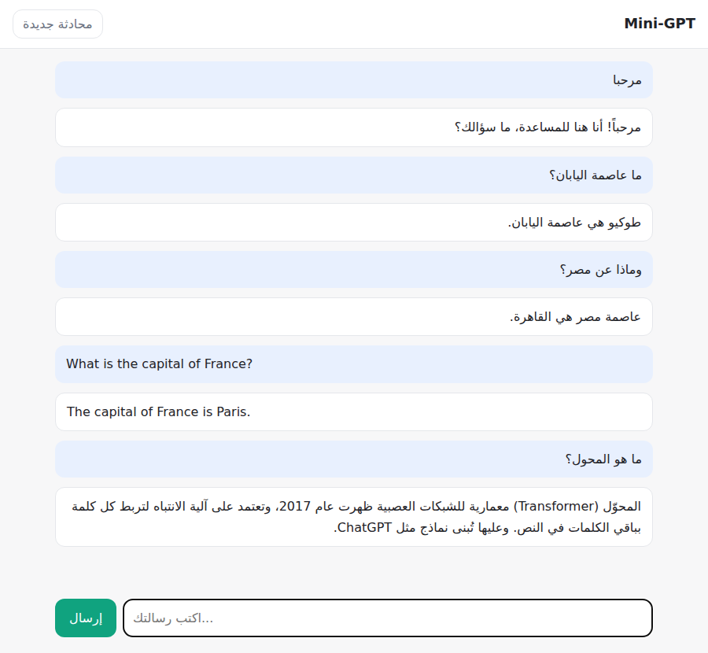

# Mini-GPT 🤖

**نموذج ذكاء اصطناعي للمحادثة مثل ChatGPT، مبني من الصفر بلغة بايثون ومكتبة PyTorch، ويدعم اللغة العربية.**

يبني هذا المشروع نموذجاً لغوياً بنفس معمارية ChatGPT (محوّل Transformer من نوع GPT)، ويمر بنفس مراحل بنائه: المرمّز، ثم التدريب المسبق، ثم الضبط الدقيق على المحادثات، ثم الدردشة عبر الطرفية أو واجهة ويب. كل جزء مكتوب من الصفر بكود قصير ومشروح، حتى تفهم كيف تعمل هذه النماذج من الداخل.



> **ملاحظة صريحة:** الفكرة والمعمارية هي نفسها التي يقوم عليها ChatGPT، لكن الفرق الهائل في الحجم والبيانات يجعل هذا النموذج أبسط بكثير. فهو يجيب جيداً عن أنواع الأسئلة التي تدرّب عليها، لكنه لا يملك معرفة ChatGPT العامة.

|                | ChatGPT                                  | Mini-GPT                          |
|----------------|------------------------------------------|-----------------------------------|
| المعمارية      | Transformer (GPT)                        | Transformer (GPT) — نفسها         |
| عدد المعاملات  | مئات المليارات (GPT-3 وحده 175 ملياراً)  | نحو 2 مليون (قابل للزيادة)        |
| بيانات التدريب | تريليونات الرموز من الإنترنت والكتب      | نص عربي صغير + 6000 محادثة مولّدة |
| العتاد         | آلاف المعالجات الرسومية لأشهر            | حاسوب شخصي في نحو 10 دقائق        |

## التشغيل السريع

```bash
pip install -r requirements.txt

python data/build_chat_data.py   # 1) توليد بيانات المحادثة (ثانية واحدة)
python train.py                  # 2) التدريب المسبق على النص العربي (~2 دقيقة)
python finetune.py               # 3) الضبط الدقيق ليصبح مساعداً (~8 دقائق)
python chat.py                   # 4) تحدّث معه في الطرفية
python web.py                    # أو افتح واجهة ويب مثل ChatGPT على http://127.0.0.1:8000
```

الأوقات تقريبية على معالج عادي (CPU) بأربع أنوية، ومع بطاقة رسومية (GPU) يصبح التدريب أسرع بكثير. ويُختار الجهاز تلقائياً.

أوامر أخرى مفيدة:

```bash
python chat.py --prompt "ما عاصمة اليابان؟"                           # سؤال واحد
python chat.py --temperature 0                                       # إجابات حتمية (الأكثر احتمالاً دائماً)
python chat.py --model-dir out/pretrain --complete "الذكاء الاصطناعي"  # إكمال نص بالنموذج المدرّب مسبقاً فقط
```

## مثال على محادثة حقيقية

```
أنت: السلام عليكم
Mini-GPT: وعليكم السلام ورحمة الله! كيف يمكنني مساعدتك اليوم؟
أنت: ما عاصمة السعودية؟
Mini-GPT: عاصمة السعودية هي الرياض.
أنت: و قطر؟
Mini-GPT: الدوحة هي عاصمة قطر.
أنت: ما اليوم الذي يلي الجمعة؟
Mini-GPT: اليوم الذي يلي الجمعة هو السبت.
أنت: ما سعر الذهب اليوم؟
Mini-GPT: عذراً، لا أعرف ذلك. أنا نموذج صغير لا يتصل بالإنترنت، ومعرفتي محدودة بما تعلمته أثناء التدريب.
```

لاحظ أن «و قطر؟» لا تذكر كلمة «عاصمة»، فالنموذج فهمها من سياق المحادثة.

دقة النموذج بعد التدريب بالإعدادات الافتراضية (إجابات حتمية):

| نوع السؤال                        | الدقة  |
|-----------------------------------|--------|
| عواصم الدول بالعربية              | 45/45  |
| عواصم الدول بالإنجليزية           | 16/16  |
| اليوم التالي / الشهر السابق       | 19/19  |
| الحساب (جمع وطرح وضرب حتى 10)     | 39/60  |

الحساب هو الأضعف: ينسخ النموذج الأرقام من السؤال بشكل صحيح، لكنه أحياناً يخطئ في الناتج (مثل `7 × 8 = 62`). وهذه نقطة ضعف معروفة في النماذج اللغوية، لأنها تتوقع الرموز ولا تحسب فعلاً، ولذلك تستعين النماذج الكبيرة بأدوات مثل الآلة الحاسبة.

## مكونات المشروع

```
minigpt/
  tokenizer.py   المرمّز: ترميز أزواج البايتات (BPE) على مستوى البايت، مثل GPT-2/GPT-4
  model.py       النموذج: محوّل GPT (انتباه سببي متعدد الرؤوس + MLP + طبقات تطبيع)
  data.py        تجهيز الدفعات، وتنسيق المحادثات، وإخفاء الخسارة عن كلام المستخدم
  training.py    حلقة التدريب: AdamW، وجدولة معدل التعلم، وحفظ أفضل نقطة، والإيقاف المبكر
  assistant.py   توليد الردود وبثها كلمة بكلمة
train.py         المرحلة 1: التدريب المسبق
finetune.py      المرحلة 2: الضبط الدقيق على المحادثات (SFT)
chat.py          الدردشة في الطرفية
web.py           واجهة ويب (بدون مكتبات إضافية)
data/
  corpus.txt             نص عربي للتدريب المسبق
  build_chat_data.py     مولّد بيانات المحادثة
tests/           اختبارات (python -m pytest)
```

## كيف يعمل؟ مراحل بناء نموذج مثل ChatGPT

### 1. المرمّز (Tokenizer)
النموذج لا يقرأ الحروف مباشرة، بل يقسّم النص إلى رموز (tokens). نستخدم **ترميز أزواج البايتات (BPE)**: نبدأ من بايتات UTF-8 المفردة (256 رمزاً)، ثم ندمج أكثر زوج متجاور تكراراً في رمز جديد، ونكرر ذلك حتى نصل إلى حجم المفردات المطلوب. ولأنه يعمل على البايتات، فهو يدعم العربية (مع التشكيل) والإنجليزية والرموز التعبيرية دون أي رمز «غير معروف». ويتعلم المرمّز من النص ومن المحادثات معاً، فتحصل الكلمات الشائعة مثل «عاصمة» و«يساوي» على رموز خاصة بها.

ويضيف المرمّز رموزاً خاصة لتنظيم المحادثة: `<|user|>` و`<|assistant|>` و`<|end|>` و`<|endoftext|>`. ولا يمكن لنص المستخدم أن ينتج هذه الرموز، حتى لا يستطيع التلاعب ببنية المحادثة.

### 2. النموذج: المحوّل (Transformer)
```
الرموز ← تضمين الرمز + تضمين الموضع
      ← [ تطبيع ← انتباه سببي متعدد الرؤوس ← جمع متبقٍ
          تطبيع ← شبكة MLP                  ← جمع متبقٍ ] × n_layer
      ← تطبيع ← طبقة خطية ← احتمال كل رمز ليكون التالي
```
قلب النموذج هو **آلية الانتباه**: لكل رمز ثلاثة متجهات (استعلام Q، ومفتاح K، وقيمة V)، ويُحسب `softmax(QKᵀ/√d) V`، فيقرر كل رمز أي الرموز السابقة أهم لفهمه. والانتباه **سببي**: لا يرى الرمز إلا ما قبله، لأن النموذج يتعلم توقع الرمز التالي.

### 3. التدريب المسبق (`train.py`)
يقرأ النموذج نصاً عادياً ويتعلم توقع الرمز التالي في كل موضع (دالة الخسارة: الإنتروبيا المتقاطعة). هكذا يتعلم ChatGPT اللغة والمعرفة العامة، لكن من كمية نصوص أكبر بملايين المرات.

ومع النص الصغير المرفق يتوقف التدريب مبكراً بعد بضع مئات من الخطوات، لأن النموذج يبدأ بحفظ النص بدلاً من تعلّم اللغة (ترتفع خسارة التحقق)، ويُحفظ أفضل نموذج قبل ذلك. لذلك يكتب النموذج المدرّب مسبقاً وحده كلاماً يشبه العربية لكن بلا معنى، وكلما زاد النص تحسّن ذلك.

### 4. الضبط الدقيق للمحادثة (`finetune.py`)
النموذج المدرّب مسبقاً يكمل النصوص فقط، ولا يعرف أنه مساعد. لذلك ندرّبه على محادثات بهذا التنسيق:
```
<|user|>ما عاصمة مصر؟<|end|><|assistant|>عاصمة مصر هي القاهرة.<|end|>
```
وتُحسب الخسارة **على ردود المساعد فقط**، فيتعلم أن يجيب لا أن يقلّد المستخدم. وتحتوي البيانات على محادثات متعددة الأدوار، مثل «ما عاصمة فرنسا؟» ثم «وماذا عن ألمانيا؟»، فيتعلم النموذج استخدام سياق المحادثة، وعلى أسئلة خارج معرفته ليتعلم أن يقول «لا أعرف».

### 5. التوليد
عند الدردشة نبني المحادثة بنفس التنسيق وننهيها بـ `<|assistant|>`، ثم يولّد النموذج رمزاً بعد رمز حتى يصل إلى `<|end|>`. وتتحكم خيارات `--temperature` و`--top-k` و`--top-p` في مدى عشوائية الإجابة. وإذا طالت المحادثة عن نافذة السياق (256 رمزاً) تُحذف الرسائل الأقدم.

### 6. ما لا يتضمنه المشروع
يُحسَّن ChatGPT بعد ذلك بمرحلة **التعلم المعزز من تقييمات البشر (RLHF)**، إذ يقارن الناس بين الإجابات ويتعلم النموذج تفضيلاتهم. هذه المرحلة غير مطبقة هنا، وهي خطوة تالية مناسبة إن أردت التوسع.

## اجعله أذكى

- **بيانات أكثر:** أهم عامل على الإطلاق. ضع أي نصوص عربية (ويكيبيديا، كتب، مقالات) في ملفات `.txt`:
  ```bash
  python train.py --data wiki.txt books.txt --vocab-size 8000
  ```
- **نموذج أكبر مع GPU:** مثلاً نحو 30 مليون معامل:
  ```bash
  python train.py --data wiki.txt --vocab-size 16000 --n-layer 8 --n-head 8 --n-embd 512 \
                  --block-size 512 --batch-size 64 --max-iters 20000 --dropout 0.0
  ```
- **محادثات خاصة بك:** أضف أسطراً إلى `data/chat.jsonl` بهذا الشكل (أو عدّل `data/build_chat_data.py`):
  ```json
  {"messages": [{"role": "user", "content": "سؤال"}, {"role": "assistant", "content": "جواب"}]}
  ```

## الاختبارات

```bash
pip install pytest
python -m pytest
```

---

### English summary

Mini-GPT is a from-scratch, ChatGPT-style assistant in PyTorch with Arabic support: a byte-level BPE tokenizer, a GPT decoder-only Transformer, pretraining on raw text with early stopping, supervised chat fine-tuning with the loss masked to assistant turns, and a terminal chat plus a streaming web UI. The four quick-start commands train it on a 4-core laptop CPU in about 10 minutes.
